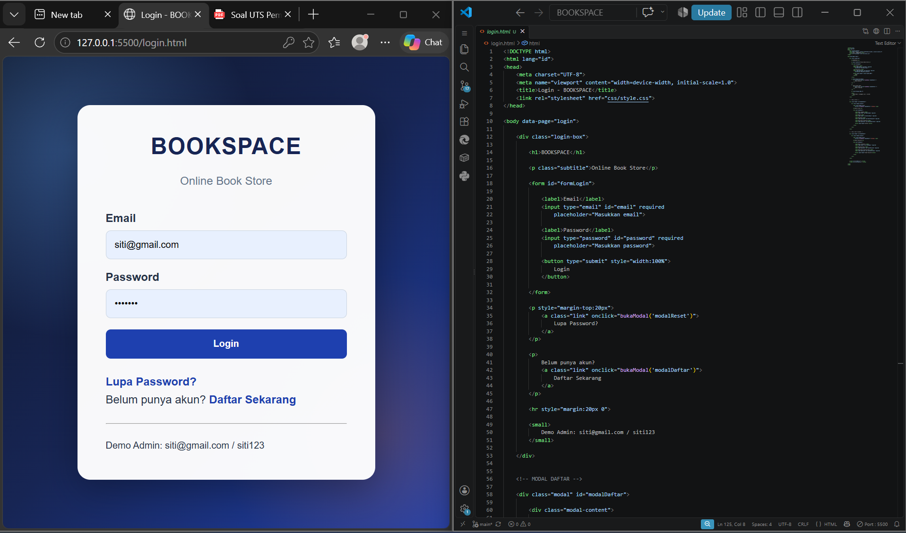
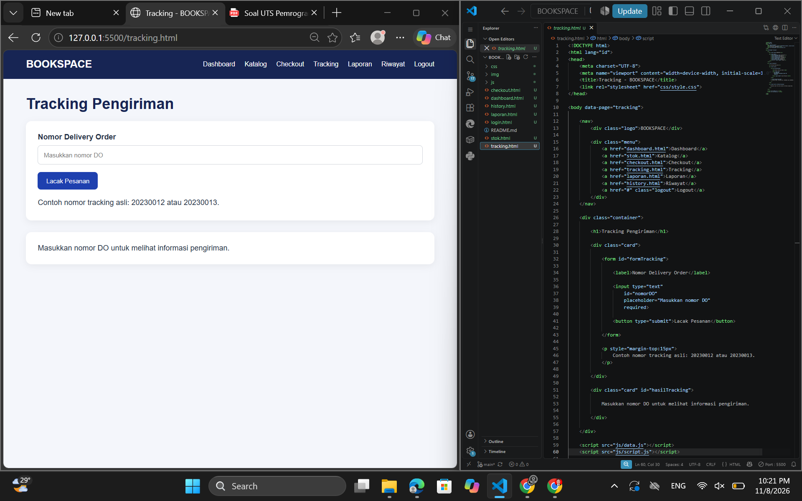

# BOOKSPACE – Online Book Store 

## Tentang Project

BOOKSPACE adalah website toko buku online sederhana yang saya buat untuk memenuhi tugas Ujian Tengah Semester (UTS) mata kuliah Pemrograman Web 1.

Website ini dibuat untuk memberikan gambaran bagaimana proses pembelian buku secara online, mulai dari pengguna login, melihat daftar buku, melakukan pemesanan, hingga mengecek status pengiriman.

Dalam pembuatan website ini, saya menggunakan HTML, CSS, dan JavaScript. Website juga dilengkapi dengan dua jenis pengguna, yaitu Admin dan User, yang memiliki fungsi berbeda.

## Tujuan Pembuatan

Tujuan saya membuat website BOOKSPACE adalah untuk menerapkan materi yang sudah dipelajari selama perkuliahan, khususnya penggunaan HTML, CSS, dan JavaScript dalam membangun sebuah website.

Selain itu, melalui project ini saya mencoba membuat beberapa fitur yang saling terhubung agar website dapat digunakan seperti toko buku online pada umumnya.

## Fitur yang Tersedia

Berikut beberapa fitur yang terdapat pada website BOOKSPACE:

1. **Login**  
   Digunakan untuk masuk ke website menggunakan email dan password.

2. **Registrasi dan Reset Password**  
   Pengguna dapat membuat akun baru dan menggunakan fitur reset password yang tersedia.

3. **Dashboard**  
   Menampilkan halaman utama setelah pengguna berhasil login.

4. **Katalog Buku**  
   Menampilkan daftar buku beserta informasi nama, kode, harga, stok, dan gambar cover buku.

5. **Pengelolaan Buku**  
   Admin dapat menambahkan, mengedit, dan menghapus data buku.

6. **Checkout**  
   Pengguna dapat mengisi data pemesanan, memilih buku, menentukan jumlah pembelian, dan memilih metode pembayaran.

7. **Tracking Pesanan**  
   Digunakan untuk mengecek pesanan menggunakan nomor Delivery Order (DO).

8. **Laporan**  
   Admin dapat melihat data pesanan dan memperbarui status pesanan.

9. **History Transaksi**  
   Menampilkan riwayat transaksi yang sudah dilakukan.

10. **Logout**  
    Digunakan untuk keluar dari akun dan kembali ke halaman login.

## Teknologi yang Digunakan

Dalam pembuatan website BOOKSPACE, saya menggunakan:

- **HTML** untuk membuat struktur halaman website.
- **CSS** untuk mengatur warna, tata letak, ukuran, dan tampilan website.
- **JavaScript** untuk menjalankan fungsi dan membuat website menjadi interaktif.
- **LocalStorage** untuk menyimpan data pada browser.

## Struktur Folder

Berikut struktur folder dari project BOOKSPACE:

BOOKSPACE/
│
├── login.html
├── dashboard.html
├── stok.html
├── checkout.html
├── tracking.html
├── laporan.html
├── history.html
│
├── css/
│   └── style.css
│
├── js/
│   ├── data.js
│   └── script.js
│
├── img/
│   ├── kepemimpinan.jpg
│   ├── manajemen_keuangan.jpg
│   ├── mikrobiologi.jpg
│   ├── paud_perkembangan.jpg
│   └── pengantar_komunikasi.jpg
│
├── screenshots/
│
└── README.md

## Dokumentasi Tampilan Website

Berikut beberapa hasil tangkapan layar dari website BOOKSPACE yang sudah dibuat.

### 1. Halaman Login

Halaman ini merupakan tampilan awal ketika pengguna membuka website. Pengguna harus memasukkan email dan password untuk masuk ke dalam sistem.

### 2. Halaman Dashboard

Setelah berhasil login, pengguna akan diarahkan ke halaman dashboard. Halaman ini menampilkan informasi utama dari website BOOKSPACE.

### 3. Halaman Katalog Buku

Halaman katalog digunakan untuk melihat daftar buku yang tersedia, termasuk informasi harga, stok, dan cover buku.

### 4. Proses Tambah Buku

Pada bagian ini Admin dapat menambahkan buku baru melalui formulir yang tersedia. Data buku yang berhasil ditambahkan akan muncul pada daftar katalog.

### 5. Proses Edit Buku

Fitur edit digunakan untuk mengubah informasi buku yang sudah ada di dalam katalog.

### 6. Halaman Checkout

Halaman checkout digunakan ketika pengguna ingin melakukan pemesanan buku. Pengguna perlu mengisi informasi pelanggan, memilih buku, jumlah pembelian, dan metode pembayaran.

### 7. Halaman Tracking

Setelah melakukan pemesanan, pengguna dapat mengecek status pesanan melalui nomor Delivery Order (DO) pada halaman tracking.

### 8. Halaman Laporan

Halaman laporan digunakan oleh Admin untuk melihat pesanan yang masuk dan memperbarui status pesanan.

### 9. Halaman History

Halaman history menampilkan riwayat transaksi yang sudah dilakukan oleh pengguna.

### 10. Proses Logout

Fitur logout digunakan untuk mengakhiri sesi pengguna dan kembali ke halaman login.

## Akun untuk Pengujian

Berikut akun yang dapat digunakan untuk mencoba website BOOKSPACE.

**Admin**

| Email | Password |
|---|---|
| siti@gmail.com | siti123 |

**User**

| Email | Password |
|---|---|
| rina@gmail.com | rina123 |
| agus@gmail.com | agus123 |

## Pengujian Website

Beberapa fitur yang sudah dicoba dalam pengujian website BOOKSPACE:

| No. | Fitur | Hasil Pengujian |
|---|---|---|
| 1 | Login dengan data salah | Menampilkan pesan kesalahan |
| 2 | Login dengan data benar | Berhasil masuk ke dashboard |
| 3 | Registrasi | Dapat membuat akun baru |
| 4 | Reset password | Dapat memperbarui password |
| 5 | Katalog buku | Data buku berhasil ditampilkan |
| 6 | Tambah buku | Data buku berhasil ditambahkan |
| 7 | Edit buku | Data buku berhasil diperbarui |
| 8 | Hapus buku | Data buku berhasil dihapus |
| 9 | Checkout | Pesanan berhasil dibuat |
| 10 | Tracking | Informasi pesanan dapat ditampilkan |
| 11 | Laporan | Status pesanan dapat diperbarui |
| 12 | History | Riwayat transaksi dapat ditampilkan |
| 13 | Logout | Berhasil kembali ke halaman login |

## Cara Menjalankan Website

Untuk menjalankan website BOOKSPACE, langkah-langkahnya sebagai berikut:

1. Download atau clone repository BOOKSPACE.
2. Buka folder BOOKSPACE menggunakan Visual Studio Code.
3. Pastikan seluruh file dan folder sudah tersedia.
4. Jalankan file `login.html` menggunakan browser atau ekstensi Live Server.
5. Masukkan salah satu akun pengujian yang tersedia.
6. Website siap digunakan.

## Video Presentasi

Untuk melihat penjelasan dan demonstrasi penggunaan website BOOKSPACE secara langsung, silakan kunjungi video berikut:

**Link YouTube:** [Video Presentasi BOOKSPACE](https://youtu.be/ZAEwYVlIKk0?si=lDFF9aLIb7OwvIMl)

## Penutup

Demikian project BOOKSPACE yang saya buat untuk memenuhi tugas UTS Pemrograman Web 1.

Melalui project ini, saya mendapatkan pengalaman dalam membuat website menggunakan HTML, CSS, dan JavaScript, mulai dari menyusun tampilan halaman, membuat fitur interaktif, hingga mengelola data menggunakan LocalStorage.

